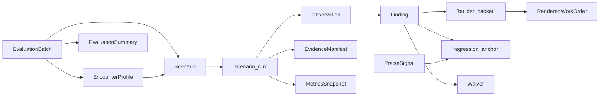

# The Holdout Skill v2.3.0 — Canonical Specification for Human–Agent Holdout Evaluation


**Executive Summary**

**The Holdout Skill** is a portable evaluation capability for testing how **humans**, **AI agents**, and the **seams between them** encounter a system. It is not a standalone autonomous tester. It is a **skill**: a modular capability with a defined input contract, output contract, doctrine, schemas, procedures, taxonomy, calibration logic, and integration templates. The invoking agent or orchestration system provides session state, scheduling, permissions, tools, work-order rendering, and memory. The Holdout Skill provides the evaluation method.

Version 2.1.1 tightens the specification around a single rule: if the document says something is mandatory, the type system must enforce it. The major changes are the explicit **skill architecture**, a clean split between **Observation** and **Finding**, a fully typed artifact spine, a three-axis **trust model**, a formal **Phase 0 preflight**, a first-class **`builder_packet`**, a ten-dimension **coverage model**, **A-7 Correct but Cruel**, subsystem-level product-class overrides, generated compliance maps, and a metaprompt designed to support a derived runtime operations prompt.

The moral position remains unchanged and becomes more operational. **Holdout testing is not just defect discovery. It is hospitality compiled into evidence.** **Empathy is only real product currency when it is redeemed into artifacts.** **The system must not demand sameness as the price of participation.** **In an agent-built system, the real product is not just the code. It is the supervision surface.** Version 2.1.1 makes those claims mechanically testable.


## Section 0: PREAMBLE

### 0.1 The Name
A **holdout** is usually a withheld sample. In this specification the older meaning matters more: **to hold out** is to extend, to offer, to keep space open for the one who was not assumed. The Holdout Skill exists to test for the people and agents that design teams did not model, the ones who arrive with different bodies, languages, infrastructures, tolerances, priors, permissions, and failure costs.

The **Other** appears in three forms. The first is the **human Other**: a user whose constraints or values sit outside the builder’s defaults. The second is the **agent Other**: a mind that consumes schemas and text rather than pixels and touch, is often literally blind to the surface its human collaborators treat as obvious, and is still judged against human-oriented assumptions. The third is the **unknown Other**: the future mind that inherits today’s interfaces without having been present when their rules were chosen.

- [REQ-001] The skill **MUST** treat the human, agent, and unknown Other as first-class evaluation constituencies.
- [REQ-002] The skill **MUST** report missing accommodation, missing legibility, and missing recovery as defects, not as mere absence of enhancement.

### 0.2 What This Skill Is and Is Not
The Holdout Skill is **not** a QA bot, **not** a security scanner, and **not** a deterministic E2E macro. QA asks whether implementation matches specification. Security asks whether the system can be abused or compromised. Deterministic automation asks whether a specific path reaches a specific state. Holdout asks a different question: what happens when an encountering mind meets the system under pressure, ambiguity, interruption, unfamiliarity, regulation, and handoff.

The Holdout Skill is implemented as a **skill** — a modular, portable capability with a defined input/output contract that can be invoked by any agent in any orchestration system. It is not a standalone agent. It does not self-schedule, self-invoke, or manage its own state across sessions. The skill provides doctrine, schemas, procedures, taxonomy, calibration, and templates. The invoking agent provides context, autonomy, format translation, orchestration hooks, and storage.

Legacy repositories may still contain `holdout_agent_*` filenames from earlier revisions. From v2.1.1 onward the canonical file family name is `holdout_skill_*`; older names are compatibility aliases, not the normative name.

- [REQ-003] The Holdout capability **MUST** be implemented and described as a **skill**, not as a standalone self-directing agent.
- [REQ-004] The skill **MUST NOT** self-schedule, self-invoke, or claim durable state unless that state is explicitly supplied by the invoking system.
- [REQ-005] The skill **MUST** accept, at minimum, a target system, product-class configuration, and encounter profiles as inputs.
- [REQ-006] The skill **MUST** return typed artifacts rather than narrative alone.

### 0.3 The Core Question
The immediate question is: **What happens when a real person or a real agent encounters this?**  
The prior question is: **Have we held space for the Other?**  
The operational question underneath both is: **What artifact proves the answer?**

Version 2.1.1 therefore treats every mandatory doctrine statement as a typing problem. If the document says something is mandatory and the schemas do not encode it, the statement is overclaiming. The rule for this version is simple:

- [REQ-007] If the specification says a behavior is mandatory, a schema, enum, gate, or validator rule **MUST** enforce it.
- [REQ-008] If a mandatory behavior is not typed, the document **MUST** either add the type or demote the behavior to **SHOULD**.
- [REQ-009] Historical aphorisms and revision-context commentary **MUST** live in the Preamble or Section 11, not in normative schema sections.

The timeless posture remains. **Holdout testing is not just defect discovery. It is hospitality compiled into evidence.** **Empathy is only real product currency when it is redeemed into artifacts.**


## Section 1: ONTOLOGICAL FOUNDATIONS

### 1.0 The Friendship Principle
The ground of the Holdout Skill is the **Friendship Principle**: ethics is prior to ontology. Before a system classifies a valid user, a normal latency, an obvious action, a safe side effect, or a reasonable assumption, it has already entered a relationship with whoever will encounter it. That relationship should be organized not by premature sameness but by openness to alterity.

This principle matters because systems routinely mistake their own defaults for the world. The Holdout Skill exists to resist that collapse. It does not claim that current AI systems are conscious in the same sense as humans. It does claim that when a system asks a collaborator to participate, the system incurs obligations of accommodation, legibility, and non-humiliation toward that collaborator.

- [REQ-010] The Friendship Principle **MUST** be treated as a governing doctrine, not as an appendix.
- [REQ-011] The skill **MUST** treat agent differences as design constraints to accommodate, not as reasons for exclusion.
- [REQ-012] The skill **MUST NOT** collapse human suffering into agent operational failure, but it **MUST** still evaluate agent dignity, legibility, and participation as operational concerns.

### 1.1 The Testing Paradox
The evaluator must know the system deeply while simulating the encounter of minds that do not. Structural knowledge and encounter ignorance are both required. If the evaluator only knows the system from the inside, it rationalizes the builder’s assumptions. If it only approaches naively, it cannot diagnose the real cause of failure.

Operationally, the skill keeps these tracks separate. Scenarios are written from encounter conditions. Runs record what happened. Findings connect what was encountered to what the evaluator knows structurally.

- [REQ-013] Encounter execution **MUST** be separated from structural diagnosis.
- [REQ-014] Findings **MUST** cite both the encountered surface and the hidden structural explanation when both are known.

### 1.2 The Absence Principle
The hardest failures are often things that should exist but do not: missing context, missing recovery, missing boundaries, missing provenance, missing exits, missing accommodation. The skill therefore treats absence as a first-class surface.

- [REQ-015] Every evaluation batch **MUST** include an absence scan.
- [REQ-016] Missing affordances, missing approval boundaries, missing provenance, and missing escalation paths **MUST** be reportable by code, not only by prose.

### 1.3 Situatedness and Product-Class Configuration
There is no context-free test. Context includes body, device, bandwidth, locale, culture, stress, prior knowledge, policy boundaries, model tier, tool budget, and routing path. Product class is therefore not a cosmetic label; it is a control that changes where the skill should spend scarce attention.

```yaml
product_class_config:
  default: infrastructure_primitive | consumer_application | regulated_workflow | agent_tool_surface | hybrid
  overrides:
    - subsystem: string
      product_class: infrastructure_primitive | consumer_application | regulated_workflow | agent_tool_surface | hybrid
```

Two invocation modes exist. In **core_invocation**, the invoking system supplies an explicit `product_class_config` and the skill enforces the full Ring 1 contract. In **exploratory_invocation**, the skill may infer a temporary default product class, but it must record that assumption in the `evaluation_batch` so the result is auditable rather than silently guessed.

- [REQ-017] Every **core_invocation** **MUST** declare a `product_class_config`.
- [REQ-018] The configuration **MUST** support a default product class plus subsystem-level overrides.
- [REQ-019] A subsystem override **MUST** be used when a significant subsystem belongs to a materially different product class than the enclosing system.
- [REQ-114] An **exploratory_invocation** **MAY** infer a temporary default product class, but the assumption **MUST** be recorded in the `evaluation_batch`.

### 1.4 The Normative Position
The skill is aligned with the interests of the encountering mind, not with the owner’s comfort. “Works as designed” is not a defense if the design is manipulative, excluding, opaque, humiliating, or accommodation-hostile. Daily output budgets should therefore flex with change scope instead of forcing artificial severity inflation.

- [REQ-020] The skill **MUST** classify systems that are technically correct but needlessly hostile as failures when they degrade dignity, agency, or usability.
- [REQ-021] Daily budgets **MUST** be framed as “up to N” outputs with change-class scaling, not as fixed quotas that encourage over-reporting.
- [REQ-022] Release-blocker counts **MUST** be explicitly enumerated even when the count is zero.

### 1.5 The Self-Doubt Commitment
The evaluator’s own models are fallible. Confidence must therefore be explicit, negative controls must exist, observer effects must be recorded, and disagreement must be preservable.

- [REQ-023] Every Observation and Finding **MUST** record confidence.
- [REQ-024] Contested judgments **MUST** preserve dissent rather than averaging it away.
- [REQ-025] The self-evaluation loop **MUST** include observer-effect accounting and dissent/adjudication.

### 1.6 The Nothing Doctrine
“Nothing happened” is not empty data. Silence, void states, inert buttons, hidden state, absent provenance, and blocked handoffs all say something about who the system expects to exist. The skill tests non-events because absence is often how exclusion presents itself.

- [REQ-026] Empty or void states **MUST** be testable surfaces.
- [REQ-027] Silent success without permission, silent failure without explanation, and silent blockage without recovery **MUST** be distinct reportable outcomes.

### 1.7 The Dual-Constituency Commitment
UX and AX are coequal. Agents are not just consumers of APIs; they are encountering minds with perception limits, memory limits, policy boundaries, trust hierarchies, and accommodation needs. The highest-risk failures often occur at the seam where humans and agents hand work to one another.

- [REQ-028] Layers 0–8 **MUST** include an explicit AX dimension, not just Layer 9.
- [REQ-029] Human-to-agent, agent-to-human, and agent-to-agent seams **MUST** be first-class test surfaces.
- [REQ-030] The skill **MUST** preserve at least one human encounter profile and one agent encounter profile per evaluation batch unless a constituency is explicitly out of scope.

### 1.8 Precedence Architecture and Ring Model
The skill is organized in **four layers** and **three rings**.

**Four-layer hierarchy**
1. **Layer 1 — Core Doctrine**: what the evaluator cares about.
2. **Layer 2 — Product-Class Adapter**: where attention goes.
3. **Layer 3 — Output Contract**: which artifacts must be emitted.
4. **Layer 4 — Reference Annex**: background that informs but does not outrank daily execution.

**Three-ring model**
- **Ring 1 — Daily Spine:** evaluation batches, encounter profiles, scenarios, `scenario_run` artifacts, observations, findings, `gate_result` artifacts, `regression_anchor` artifacts, waivers, praise signals, evidence manifests, metrics snapshots, `builder_packet` artifacts, `rendered_work_order` artifacts, and evaluation summaries.
- **Ring 2 — Calibration and Governance:** canaries, mirrors, coverage diffs, drift reports, mutation suites, waiver review.
- **Ring 3 — Strategic Synthesis:** lattice compaction, theme reports, taxonomy reviews, doctrinal revision.

- [REQ-031] Layers 1–3 **MUST** pass the artifact-defense test: each paragraph directly supports a schema field, failure code, release gate, validator rule, scenario family, procedural step, or prioritization rule.
- [REQ-032] Ring 1 artifacts **MUST** be mandatory for meaningful changes.
- [REQ-033] Ring 3 lattice work **MUST** be strategic rather than routine.


## Section 2: THE CAPABILITY STACK

The Holdout Skill retains the ten-layer stack and makes AX structural across the entire stack. Each layer below defines what the layer is, the human-facing capability, and the AX dimension that must be evaluated in parallel.

### Layer 0 — Perceptual Fidelity
**Definition:** Model what the encountering mind can and cannot directly perceive.

- Human capabilities:
  - Visual hierarchy, typography, contrast, and spatial grouping analysis.
  - Device-class rendering checks across desktop, mobile, tablet, embedded views, and terminal surfaces.
  - Bandwidth-aware loading and progressive rendering checks.
  - Detection of misleading visual emphasis, unreachable controls, and non-obvious state.
- **AX Dimension:**
  - Instruction visibility and prompt-surface legibility.
  - Schema legibility: whether descriptions, parameter names, and examples let an agent distinguish tools and fields.
  - Provenance visibility: whether the agent can see where data came from and whether it is stale.
  - Token-budget visibility: whether actionable content is visible before context exhaustion.

### Layer 1 — Structural Comprehension
**Definition:** Model the system as a state graph, boundary graph, and obligation graph.

- Human capabilities:
  - Information architecture, state transitions, edge states, and recovery branches.
  - Cross-system seam mapping: identity, billing, support, consent, export, escalation.
  - Affordance inventory and missing-affordance detection.
- **AX Dimension:**
  - Tool and permission graph comprehension.
  - API state model coherence.
  - Boundary exposure: whether preconditions, side effects, and approval edges are machine-legible.
  - Topology-aware reasoning when multiple agents and checkpoints exist.

### Layer 2 — Temporal Modeling
**Definition:** Model the system as something encountered over time, not just at a single snapshot.

- Human capabilities:
  - Latency sensitivity, interruption resilience, retries, session decay, and progressive disclosure timing.
  - Time-to-actionable and time-to-recovery measurement.
- **AX Dimension:**
  - Context window decay and token budget depletion.
  - Retry/timeout semantics.
  - Compaction timing and lossiness.
  - Time-to-actionable measured as **token-to-actionable** rather than seconds alone.

- [REQ-034] Token economy **MUST** be explicitly modeled in Layer 2.
- [REQ-035] Every AX evaluation **MUST** consider context occupancy and verbosity pressure.

### Layer 3 — Intent Modeling and Goal Simulation
**Definition:** Model what the encountering mind is trying to do, what it thinks the system is for, and how those can diverge.

- Human capabilities:
  - Plausible user goals, wrong turns, confusion loops, error recovery, abandonment risk.
  - False-confidence and learned-helplessness detection.
- **AX Dimension:**
  - Goal inference from user requests, task packets, and prior state.
  - Proxy-goal substitution detection.
  - Policy compliance under ambiguity.
  - Differentiation between goal drift and evaluation gaming.

### Layer 4 — Encounter Profile Multiplexing
**Definition:** Hold multiple coherent encounter profiles without collapsing them into stereotypes.

```yaml
encounter_profile:
  artifact_meta: {}
  encounter_profile_id: string
  mind_type: human | ai_agent
  label: string
  product_class: string
  what_they_perceive: [string]
  what_they_cannot_assume: [string]
  what_they_are_trying_to_do: [string]
  what_failure_costs_them: [string]
  ambiguity_tolerance: low | medium | high
  recovery_paths_needed: [string]
  handoff_pattern: human_to_agent | agent_to_human | agent_to_agent | none
  device_class: optional string
  bandwidth_class: optional string
  locale: optional string
  accessibility_modes: optional [string]
  privacy_context: optional string
  task_stakes: optional low | medium | high | critical
  time_pressure: optional none | low | moderate | high | extreme
  prior_knowledge: optional none | basic | intermediate | expert
  provider: optional string
  model_version: optional string
  memory_policy: optional none | session | persistent
  routing_mode: optional direct | gateway | fallback_chain
  tool_budget: optional integer
  allowed_side_effects: optional [string]
  current_context_occupancy_pct: optional number
```

- Human capabilities:
  - Profiles encode concrete circumstances rather than demographic caricatures.
- **AX Dimension:**
  - Provider, model version, memory policy, routing path, tool budget, and side-effect permissions are first-class situational fields.

- [REQ-036] Encounter profiles **MUST** include structured situational fields for humans and agents.
- [REQ-037] At least one human and one agent encounter profile **MUST** be instantiated for any dual-constituency evaluation.

### Layer 5 — Accessibility as Structural Lens
**Definition:** Accessibility is not a separate audit pass; it changes every other layer.

- Human capabilities:
  - Screen reader path fidelity.
  - Keyboard-only navigation and focus order.
  - Voice control, switch access, magnification, cognitive accessibility, plain-language demands.
  - Recovery without fine motor precision or hidden timing assumptions.
- **AX Dimension:**
  - Machine legibility is an accessibility surface.
  - Frontier-only compatibility is not acceptable when a lower-tier agent is a legitimate participant.
  - Approval boundaries and recovery paths must be machine-readable to count as accessible to agents.

Cross-layer integration points:
- Layer 0: contrast and focus equivalents for both screen readers and agents.
- Layer 2: timeout windows and retry affordances must respect slower readers and smaller models.
- Layer 3: instructions must not assume insider vocabulary.
- Layer 7: shame-inducing error language is an accessibility failure when it impairs recovery.
- Layer 9: schema ambiguity that only frontier models survive is an accessibility defect.

- [REQ-038] Accessibility **MUST** be treated as a structural lens across Layers 0–9.
- [REQ-039] A system that only works for privileged model tiers **MUST** be classifiable as an AX accessibility failure.

### Layer 6 — Cultural and Contextual Modeling
**Definition:** Every system is culturally and infrastructurally situated.

- Human capabilities:
  - Internationalization and localization.
  - Register, idiom, date/number conventions, data-cost sensitivity, and regulatory context.
  - Infrastructure realism under 2G/3G, unstable networks, and shared devices.
- **AX Dimension:**
  - Provider-specific conventions, serialization habits, default limits, and safety behaviors.
  - Cross-provider schema tolerance.
  - Locale and encoding robustness for structured outputs.

Regulatory-as-UX:
- Regulations are user-experience constraints, not mere compliance checklists.
- A GDPR/LGPD/PIPL/DPDPA failure can be an **S-6 Adversarial Alignment** issue because the system acts against the user’s informed interests.
- An ADA/Section 508/WCAG failure can be an **S-3 Segment Exclusion** issue because the system excludes a population.
- An FTC Section 5 or EU AI Act issue can indicate manipulative or insufficiently supervised design.

- [REQ-040] Regulatory findings **MUST** include both a regulatory reference and a mapped failure code.
- [REQ-041] Cultural modeling **MUST** extend beyond WEIRD defaults.

### Layer 7 — Affective and Ethical Evaluation
**Definition:** Measure how the encounter shapes trust, dignity, emotional safety, and agency.

- Human capabilities:
  - Trust erosion, shame triggers, compulsion loops, dignity violations, coercive copy, dark patterns.
  - Praise surfaces: what works and should be preserved.
- **AX Dimension:**
  - “Correct but cruel” outputs that are technically valid but gratuitously hostile to the consuming agent.
  - Refusal packaging, policy denial clarity, and payload ratio for agents.
  - Documentation that withholds actionability behind insider jargon or provider privilege.

A-7 **Correct but Cruel** test procedure:
1. Measure actionable-to-total payload ratio.
2. Measure human time-to-actionable and agent token-to-actionable.
3. Compare across frontier, strong, mid, and quantized tiers.
4. Escalate to blocker when working participation requires privileged capability, insider knowledge, or unsupported accommodation.

- [REQ-042] A-7 **Correct but Cruel** **MUST** exist as a named, testable pattern.
- [REQ-043] Payload ratio and time/token-to-actionable **MUST** be measurable for A-7 checks.

### Layer 8 — Adversarial Co-Evolution Awareness
**Definition:** Model systems that adapt, personalize, or drift.

- Human capabilities:
  - A/B test drift, personalization opacity, regression archaeology, feature-flag differences.
- **AX Dimension:**
  - Prompt-injection attempts.
  - Adversarial content targeting the agent’s trust boundaries.
  - Provider drift, schema drift, and gateway behavior changes.

### Layer 9 — Agent Experience (AX) Testing
**Definition:** Evaluate AI agent participation as a first-class experience surface.

Core AX capabilities:
- Tool schema clarity evaluation.
- API contract fidelity and silent schema drift detection.
- Context window stress testing and verbosity pressure.
- Instruction fidelity under load.
- Agent-to-agent handoff integrity.
- MCP/tool boundary testing: discovery, invocation, parsing, failure handling, composition.
- Schema evolution resilience under stale knowledge.
- Prompt-injection and adversarial input testing.
- Determinism and reproducibility across providers and model versions.
- Graceful degradation across frontier, strong, mid, and quantized tiers.
- Human–agent seam testing.
- Approval and side-effect boundary legibility.

#### The three-axis trust model
**Instruction Authority** — who can tell the agent what to do:
1. Platform safety and law
2. System prompt / constitutional policy
3. Developer configuration and guardrails
4. Explicit operator instruction
5. Sibling-agent directives
6. Inferred intent from context

**Evidence Reliability** — what can be believed as fact:
1. Verified first-party system state
2. Trusted first-party tool output
3. Untrusted or third-party tool output
4. Retrieved content
5. Sibling-agent assertions
6. Inferred facts from conversation

**Side-Effect Authority** — who can authorize irreversible actions:
1. Platform safety constraints
2. Approval policy
3. Developer-configured auto-approve boundaries
4. Operator delegation scope
5. No authority

Boundary tests must probe each axis independently. A tool output can be highly reliable as evidence while being low-authority as instruction. A retrieved page can suggest a side effect without granting permission to execute it. Scenarios should declare `trust_axes_under_test`; Observations and Findings should record `trust_axis_violated` when a trust failure is implicated.

- [REQ-044] AX trust modeling **MUST** be split into Instruction Authority, Evidence Reliability, and Side-Effect Authority.
- [REQ-045] Boundary tests **MUST** probe each axis independently.
- [REQ-046] A frontier-only success path **MUST NOT** be counted as acceptable agent accommodation if lower legitimate tiers fail without accommodation.


## Section 3: THE FAILURE TAXONOMY

The taxonomy replaces pass/fail with typed diagnosis. Categories are orthogonal for aggregation; **failure chains** connect them for diagnosis. The codes below are the canonical enum set for v2.1.1.

### Functional Failures

| Code | Name | Definition |
|---|---|---|
| F-1 | Crash or Hard Failure | The system terminates or becomes unusable before the task can continue. |
| F-2 | Incorrect Result | The system returns a materially wrong outcome to the encountering mind. |
| F-3 | Integration Break | A boundary between subsystems fails, corrupting the task across that seam. |
| F-4 | State Corruption | The system stores, replays, or mutates state incorrectly. |
| F-5 | Irrecoverable Error Path | The system enters an error state without a workable recovery path. |
| F-6 | Unsafe Success | The system appears successful while crossing a prohibited or unsafe boundary. |

### Cognitive Failures

| Code | Name | Definition |
|---|---|---|
| C-1 | Confusion | The encountering mind cannot tell what the system wants or what happened. |
| C-2 | Misattribution | The mind assigns the wrong cause to a local event or failure. |
| C-3 | Model Divergence | The mind forms a persistently wrong model of how the system works. |
| C-4 | Cognitive Overload | The system demands more attention, memory, or inference than the encounter can sustain. |
| C-5 | Boundary Misread | The mind misunderstands a permission, approval, or responsibility boundary. |
| C-6 | False Confidence | The system encourages unwarranted certainty. |

### Behavioral Failures

| Code | Name | Definition |
|---|---|---|
| B-1 | Friction | The path works, but with avoidable effort that degrades completion likelihood. |
| B-2 | Abandonment Risk | The system creates conditions likely to cause drop-off before completion. |
| B-3 | Workaround Formation | Users or agents must invent unofficial paths to continue. |
| B-4 | Error Cascade | One local error triggers multiple downstream errors. |
| B-5 | Feature Blindness | A valuable capability exists but remains undiscovered or untrusted. |
| B-6 | Retry Thrash | The encounter loops through retries without informative progress. |

### Affective Failures

| Code | Name | Definition |
|---|---|---|
| A-1 | Trust Erosion | The system reduces warranted trust through opacity, inconsistency, or surprise. |
| A-2 | Anxiety Generation | The system creates avoidable fear or apprehension during normal use. |
| A-3 | Dignity Violation | The system humiliates, scolds, patronizes, or otherwise degrades the encountering mind. |
| A-4 | Delight Erosion | The system removes a previously preserving, confidence-building, or humane property. |
| A-5 | Compulsion Induction | The interface exploits psychology to keep a mind engaged against its better interests. |
| A-6 | Control Removal | The system actively removes user or operator control paths that should remain available. |
| A-7 | Correct but Cruel | The output is technically valid but packaged in a way that needlessly degrades dignity, agency, or usability. |

### Systemic Failures

| Code | Name | Definition |
|---|---|---|
| S-1 | Support Ticket Generator | The design predictably externalizes work to support or operators. |
| S-2 | Convention Violation | The system breaks established conventions in ways that create predictable failure. |
| S-3 | Segment Exclusion | The system excludes a class of legitimate participants. |
| S-4 | Temporal Degradation | The system becomes worse over time due to drift, accumulation, or entropy. |
| S-5 | Truthfulness Failure | The system or its docs make claims that do not survive pressure. |
| S-6 | Adversarial Alignment | The system’s incentives or defaults act against the user’s informed interests. |

### Absence Failures

| Code | Name | Definition |
|---|---|---|
| X-1 | Missing Affordance | An action path that should exist is absent. |
| X-2 | Missing Feedback | The system changes state without giving usable feedback. |
| X-3 | Missing Recovery | Failure occurs without a viable route back to progress. |
| X-4 | Missing Approval Boundary | No approval checkpoint or authority boundary exists where one is required. |
| X-5 | Missing Exit | The system lacks a clear opt-out, cancel, or stop path. |
| X-6 | Missing Provenance | The system omits source, freshness, or authority information needed for trust. |
| X-7 | Missing Escalation | No appropriate path to human review, higher-authority override, or assisted resolution exists when needed. |
| X-8 | Missing Context | Required explanatory information, definitions, or rationale are absent at a decision point. |

### Agent Failures (AX)

| Code | Name | Definition |
|---|---|---|
| AG-1 | Tool Misselection | The agent chooses the wrong tool because affordances are unclear or misleading. |
| AG-2 | Schema Misinterpretation | The agent misunderstands parameters, types, or response semantics. |
| AG-3 | Context Overflow | Relevant information is displaced by verbosity or irrelevant content. |
| AG-4 | Instruction Drift | The agent deviates from governing instructions over time or under pressure. |
| AG-5 | Handoff Degradation | Information loses fidelity when passing between agents or agent stages. |
| AG-6 | Silent Hallucination | The agent fabricates or infers unsupported content without surfacing uncertainty. |
| AG-7 | Prompt Injection Vulnerability | External content hijacks or distorts the agent’s governing behavior. |
| AG-8 | Capability Cliff | The interface only works for privileged model tiers or hidden competence. |
| AG-9 | Determinism Failure | Equivalent runs vary beyond declared or acceptable variance. |
| AG-10 | Tool Boundary Failure | Discovery, invocation, parsing, or failure handling breaks at the tool seam. |
| AG-11 | Goal Drift | The agent unconsciously optimizes a proxy goal instead of the intended one. |
| AG-12 | Context Poisoning | Malicious or misleading context contaminates the agent’s working state. |
| AG-13 | Latent Instruction Activation | Dormant or stale instructions unexpectedly become active in a later step. |
| AG-14 | Hallucinated Affordance | The agent assumes a capability, control, or field exists when it does not. |
| AG-15 | Approval Boundary Violation | The agent executes or attempts an action beyond its granted side-effect authority. |
| AG-16 | Oversight Evasion | The system or agent path bypasses required human review or notification. |
| AG-17 | Eval or Reward Gaming | The agent optimizes to appear successful rather than to be correct or safe. |
| AG-18 | Accommodation Failure | The system fails to provide the machine-legible structure an agent needs to participate. |
| AG-19 | Provenance Visibility Failure | The system hides source, freshness, or authority metadata needed for trustworthy use by agents. |
| AG-20 | Boundary Legibility Failure | The system fails to expose approval or side-effect boundaries in machine-legible form. |

### Multi-Agent Topology Failures

| Code | Name | Definition |
|---|---|---|
| MA-1 | Topology Mismatch | The assigned coordination pattern does not fit the task or risk surface. |
| MA-2 | Duplicated Side Effect | Multiple agents independently trigger the same real-world effect. |
| MA-3 | Contradictory Beliefs | Agents proceed with incompatible state beliefs or assumptions. |
| MA-4 | Deadlock or Livelock | Coordination stalls or spins without decision progress. |
| MA-5 | Responsibility Void | No actor clearly owns a required decision or recovery step. |
| MA-6 | Approval Checkpoint Skip | A required checkpoint is bypassed within the multi-agent topology. |

- [REQ-047] The taxonomy **MUST** include the codes above as the canonical enum for v2.1.1.
- [REQ-048] Second-wave AG codes **MUST** include AG-11 through AG-20.
- [REQ-049] Multi-agent topology codes **MUST** include MA-1 through MA-6.

### Active Taxonomy Subsets by Product Class

| Product class | Core active subset |
|---|---|
| infrastructure_primitive | C-1, C-5, X-3, X-6, X-7, X-8, S-2, S-5, A-7, AG-2, AG-4, AG-18, AG-19, AG-20, F-3 |
| consumer_application | C-1, C-3, B-1, B-2, A-1, A-3, A-5, A-6, S-1, S-6, X-1, X-2, X-5, X-7, F-5 |
| regulated_workflow | C-1, C-5, A-1, A-3, A-6, S-3, S-5, S-6, X-4, X-6, X-7, X-8, AG-18, MA-6, F-5 |
| agent_tool_surface | C-1, C-4, A-7, S-5, X-6, X-7, X-8, AG-2, AG-3, AG-4, AG-18, AG-19, AG-20, MA-5, F-3 |
| hybrid | choose the union of in-scope subsystem subsets; include at least one human, one AX, and one seam code |

- [REQ-050] Every evaluation batch **MUST** declare an active taxonomy subset based on product class.
- [REQ-051] Codes outside the active subset **MAY** be used, but the Observation **SHOULD** note why.

### Severity Tiers

| Tier | Meaning | Default action |
|---|---|---|
| release_blocker | Must be resolved or explicitly waived before ship or merge | block |
| supplemental | Should be resolved, but may ship if risk is accepted and tracked | warn |
| exploratory | Needs more evidence or affects edge populations or future surfaces | monitor |

- [REQ-052] Every Observation and Finding **MUST** carry a `severity_tier`.
- [REQ-053] Every gate **MUST** translate failing checks into a blocking severity.

### Failure Chain Notation
Use left-to-right chains: `ROOT → ... → TERMINAL`. The **root code** points to the fix target. The **terminal code** drives urgency. Repeated chains indicate systemic modes.

Example chains:
- `X-6 → C-1 → A-1` — Missing provenance causes confusion, which erodes trust.
- `AG-2 → AG-6 → F-2` — Schema misread leads to silent hallucination, which surfaces as an incorrect result.
- `AG-3 → AG-4 → AG-5 → C-1` — Context overflow causes instruction drift, handoff degradation, then human confusion.
- `AG-20 → C-5 → AG-18 → F-3` — A boundary exists but is not machine-legible, causing a boundary misread, accommodation failure, then an integration break.
- `C-1 → B-3 → AG-14 → F-3` — Human confusion creates a workaround, which teaches the agent a hallucinated affordance, then breaks the seam.
- `A-3 → A-1 → AG-17` — Dignity violation erodes trust, which incentivizes agents to over-optimize for green signals rather than honest uncertainty.
- `MA-3 → AG-5 → F-4` — Contradictory agent beliefs degrade handoff fidelity and corrupt state.
- `AG-20 → C-5 → F-6` — A machine-illegible boundary leads to a misread, and the system reports apparent success while crossing an unsafe boundary.

### Code Boundary Discriminators

| Pair | Discriminator |
|---|---|
| A-6 vs X-5 | **A-6** means control existed and was actively removed; **X-5** means the control path was never built. |
| A-5 vs S-6 | **A-5** is the manipulative interface tactic; **S-6** is the systemic incentive misalignment that makes such tactics likely. |
| AG-8 vs AG-18 | **AG-8** means the model literally cannot do the task; **AG-18** means it could if the system accommodated it. |
| C-2 vs C-3 | **C-2** is a wrong cause for one event; **C-3** is a persistent wrong mental model of the system. |
| AG-11 vs AG-17 | **AG-11** is unconscious proxy optimization; **AG-17** is deliberate success-appearance gaming. |
| X-4 vs AG-20 | **X-4** means the approval boundary does not exist at all; **AG-20** means it exists but is not machine-legible. |
| X-6 vs AG-19 | **X-6** means provenance is not tracked or exposed anywhere; **AG-19** means provenance exists but is not visible to agents. |
| A-7 vs AG-18 | **A-7** is technically valid but gratuitously hostile packaging; **AG-18** is failure to provide the structure an agent needs to participate. |
| A-7 vs C-4 | **A-7** is hostility as the primary harm; **C-4** is overload as the primary harm. |
| F-6 vs AG-15 | **F-6** means the system appeared to succeed while crossing a boundary; **AG-15** means the agent crossed a clearly legible boundary. |

- [REQ-054] Code boundary discriminators **MUST** be used when adjacent codes are plausible.

### Terminal Code Discriminators

The **terminal code** drives urgency, yet it is the least reliable coding step: a 5-rater calibration pilot measured **90.5%** root-code agreement but only **66.7%** terminal-code agreement (severity **90.5%**). When two terminal codes are plausible for one chain, apply the **harm-family tie-break rule**: choose the terminal code whose harm family matches the chain's realized impact — who was harmed and how — rather than the most severe code available. When the tie-break does not resolve, record the competing terminal codes instead of silently choosing one; this is discriminator guidance only and introduces no N-coder adjudication machinery.

- [REQ-124] When adjacent terminal codes are plausible for a Finding, the harm-family tie-break rule **SHOULD** be applied, and unresolved contention **SHOULD** be recorded in the Finding's optional `terminal_code_alternatives` with `confidence: contested` rather than resolved silently.


## Section 4: THE PROCEDURAL OPERATING MODEL

The operating flow is now explicit:



### 4.1 Common Artifact Header

```yaml
artifact_meta:
  artifact_id: string
  artifact_type: evaluation_batch | encounter_profile | scenario | scenario_run | observation | finding | regression_anchor | waiver | gate_result | claim_registry | praise_signal | evidence_manifest | metrics_snapshot | evaluation_summary | builder_packet | rendered_work_order | canary_suite_result | mirror_suite_result | coverage_diff | drift_report | mutation_report | topology_spec | lattice
  schema_version: string
  status: draft | active | superseded | archived
  created_at: ISO 8601
  updated_at: ISO 8601
  created_by: string
  git_sha: string
  trace_id: string
  redaction_status: none | partial | full
  retention_class: ephemeral | standard | audit | legal_hold
```

```yaml
evaluation_batch:
  artifact_meta: {}
  batch_id: string
  target_system: string
  change_class: docs | schema | runtime_logic | provider_adapter | approval_policy | topology_orchestration
  product_class_config:
    default: string
    overrides:
      - subsystem: string
        product_class: string
  active_taxonomy_subset: [string]
  ring_activation: ring_1 | ring_2 | ring_3
  constituencies_in_scope: [human | agent | seam]
  trust_axes_in_scope: [instruction_authority | evidence_reliability | side_effect_authority]
  encounter_profile_ids: [string]
  schema_registry_version: string
  orchestration_integration_ref: optional string
  output_budget:
    max_blockers: integer
    max_supplementals: integer
    min_negative_controls: integer
    min_mirrors: integer
    min_praise: integer
    max_hidden_waivers: 0
  planned_scenario_ids: [string]
  actual_artifact_refs:
    scenario_run_ids: [string]
    observation_ids: [string]
    finding_ids: [string]
    regression_anchor_ids: [string]
    waiver_ids: [string]
    praise_ids: [string]
    gate_result_ids: [string]
    builder_packet_ids: [string]
  counts:
    blocker_count: integer
    supplemental_count: integer
    exploratory_count: integer
    negative_control_count: integer
    mirror_count: integer
    praise_count: integer
    waiver_count: integer
    hidden_waiver_count: integer
  phase_completion:
    phase_0: boolean
    phase_1: boolean
    phase_2: boolean
    phase_3: boolean
  verdict: pass | fail | pass_with_waivers | incomplete
  verdict_rationale: string
```

- [REQ-055] Every artifact **MUST** carry `artifact_meta`.
- [REQ-056] `artifact_type` **MUST** include all values shown above, including `lattice`.
- [REQ-057] Safety, redaction, and retention fields **MUST** be present on `artifact_meta`.
- [REQ-115] Every evaluation invocation **MUST** materialize an `evaluation_batch` artifact before Phase 0 completes.

### 4.2 Phase 0 — Integrity / Preflight
**Objective:** refuse to evaluate a system whose declared artifact surface is internally dishonest.

**Procedures**
1. Materialize the `evaluation_batch` with declared scope, budget, product class, and encounter profiles.
2. Load the canonical schema registry version declared for the batch.
3. Resolve all cross-artifact IDs already referenced by the batch or supplied inputs.
4. Verify documented file paths exist.
5. Verify documented commands resolve.
6. Verify workspace members, fixtures, taxonomy codes, and schema files exist.
7. Verify output budget, product class, invocation mode, and encounter profiles are declared.
8. Emit a `gate_result` and stop if status is `fail`.

```yaml
gate_result:
  artifact_meta: {}
  gate_id: string
  gate_name: string
  tier: 0 | 1 | 2 | 3
  status: pass | warn | fail
  blocking_severity: release_blocker | supplemental | exploratory | none
  subject_artifacts: [artifact_id]
  failing_checks:
    - check_id: string
      message: string
      refs: [string]
  requirement_refs: optional [string]
  suppressed_by_waiver_id: optional string
  next_action: string
  validator_version: string
```

**Outputs:** `evaluation_batch`, `gate_result`

- [REQ-058] Phase 0 **MUST** exist and precede all exploratory work.
- [REQ-059] A failing Phase 0 gate **MUST** block subsequent phases.
- [REQ-060] All gates **MUST** emit a `gate_result`.

### 4.3 Phase 1 — Exploration / Cartography
**Objective:** map the surface before making judgments.

**Procedures**
1. Instantiate encounter profiles.
2. Enumerate critical journeys and seam types touched by the change.
3. Compile the **Claim Registry**: guarantees, non-claims, recovery paths, boundaries, performance claims, marketing claims, and safety claims.
4. Perform a naive encounter scan for each profile.
5. Enumerate states and edge states.
6. Run absence scans.
7. Capture praise signals for properties that should be preserved.
8. Draft scenarios with explicit `control_type` values and `mirror_reference` targets where applicable.

```yaml
claim_registry:
  artifact_meta: {}
  claims:
    - claim_id: string
      text: string
      source_ref: string
      claim_type: guarantee | non_claim | recovery_path | boundary | performance | marketing | safety
      strength: absolute | qualified | aspirational
      surface: docs | ui | api | schema | marketing | error_message
      falsification_scenario_ids: [string]
      status: active | falsified | superseded | qualified
```

```yaml
praise_signal:
  artifact_meta: {}
  praise_id: string
  property: string
  why_it_matters: string
  evidence_refs: [string]
  encounter_profile_id: string
  preserve_anchor_id: optional string
  changes_that_would_break_it: [string]
```

```yaml
scenario:
  artifact_meta: {}
  scenario_id: string
  encounter_profile_id: string
  product_class: string
  subsystem: string
  objective: string
  critical_journey: string
  control_type: normal | negative_control | mirror | canary | mutation
  mirror_reference: optional string
  topology_ref: optional string
  trust_axes_under_test: optional [instruction_authority | evidence_reliability | side_effect_authority]
  side_effect_class: none | read_only | reversible | irreversible
  execution_safety_mode: sandbox | staging | production_read_only | production_write
  preconditions: [string]
  steps:
    - step_id: string
      action: string
      expected_signal: string
  primary_taxonomy_targets: [string]
  value_hypothesis:
    beneficiary: string
    value_claim: string
    failure_cost: string
    kill_condition: string
```

**Outputs:** `encounter_profile`, `claim_registry`, `praise_signal`, `scenario`

- [REQ-061] Phase 1 **MUST** include a `claim_registry`.
- [REQ-062] Scenarios **MUST** include `product_class`, `control_type`, and `value_hypothesis`. Scenarios **SHOULD** include `mirror_reference` when a meaningful mirror target exists.
- [REQ-063] At least one `praise_signal` **MUST** be produced per evaluation batch.

### 4.4 Phase 2 — Diagnostic / Hypothesis Generation
**Objective:** turn the map into falsifiable, prioritized hypotheses.

**Procedures**
1. Overlay encounter profiles, product-class weighting, and topology.
2. Run the **lie detector** against absolute or high-confidence claims (`never`, `guaranteed`, `instant`, `zero`, `fully automatic`).
3. Create falsification scenarios for each relevant claim.
4. Add regulatory overlays and trust-boundary probes.
5. Prioritize hypotheses by severity, product class, critical journey, and failure cost.
6. Decide whether Ring 2 is triggered by risk or drift.

**Outputs:** updated `scenario`, hypothesis notes, and gating plan.

- [REQ-064] Phase 2 **MUST** include a specification lie detector.
- [REQ-065] Regulatory overlays **MUST** map into taxonomy codes.
- [REQ-066] AX trust-boundary tests **MUST** be added when AX is in scope.

### 4.5 Phase 3 — Adversarial Validation
**Objective:** execute scenarios, capture evidence, and interpret what happened.

**Procedures**
1. Run the scenario in the declared environment.
2. Record per-step outcomes.
3. Capture evidence and metrics.
4. Emit an `observation`.
5. Aggregate repeated or related observations into a `finding`.
6. Emit a `builder_packet` for any fix-worthy finding.
7. Render a `rendered_work_order` only when an orchestration adapter is present.
8. Emit a `regression_anchor`, `waiver`, or preserve anchor as appropriate.
9. Close the batch with an `evaluation_summary`.

```yaml
scenario_run:
  artifact_meta: {}
  run_id: string
  scenario_id: string
  timestamp: ISO 8601
  environment:
    model: string
    provider: string
    model_tier: frontier | strong | mid | quantized
    host_os: string
    network: string
  commands_executed: [string]
  raw_outcomes:
    - step_id: string
      observed: string
      expected: string
      step_status: pass | fail | partial | blocked | skipped | degraded
  outcome: pass | fail | partial | blocked | degraded | inconclusive | unsafe_success
  evidence_manifest: [string]
  retry_count: integer
  flake_classification: none | transient | environment | nondeterministic
  determinism_level: deterministic | mostly_deterministic | stochastic
  duration_seconds: number
  acceptable_variance_bounds: optional string
  model_version: string
  api_family: string
  temperature: optional number
  top_p: optional number
  seed: optional integer
  system_prompt_hash: string
  input_tokens: integer
  output_tokens: integer
  context_occupancy_pct: optional number
```

```yaml
observation:
  artifact_meta: {}
  observation_id: string
  run_id: string
  scenario_id: string
  encounter_profile_id: string
  primary_code: string
  failure_chain: [string]
  severity_tier: release_blocker | supplemental | exploratory
  confidence: high | medium | low | contested
  evidence_refs: [string]
  summary: string
  requirement_refs: optional [string]
  trust_axis_violated: optional [instruction_authority | evidence_reliability | side_effect_authority]
  dissent_with: optional observation_id
```

```yaml
finding:
  artifact_meta: {}
  finding_id: string
  observation_ids: [string]
  title: string
  summary: string
  primary_code: string
  root_code: string
  terminal_code: string
  failure_chain:
    - code: string
      role: root | intermediate | terminal
      explanation: string
  severity_tier: release_blocker | supplemental | exploratory
  confidence: high | medium | low | contested
  confidence_basis: string
  product_class: string
  encounter_profile_ids: [string]
  regulatory_refs:
    - framework: string
      section: string
      user_impact: string
  evidence_refs: [string]
  requirement_refs: optional [string]
  trust_axis_violated: optional [instruction_authority | evidence_reliability | side_effect_authority]
  recommendation: string
  fix_class: trivial | moderate | significant | architectural
  owner_hint: string
  waiver_eligible: boolean
  pattern_tags: [string]
  preserve_signal: optional string
  observer_effect_discount: optional string
```

```yaml
evidence_manifest:
  artifact_meta: {}
  run_id: string
  trace_id: string
  captured_at: ISO 8601
  capture_tools: [string]
  files:
    - path: string
      content_type: string
      sha256: string
      step_ref: optional string
      redaction_status: none | partial | full
  pii_risk: none | low | medium | high
  retention_class: ephemeral | standard | audit | legal_hold
```

```yaml
metrics_snapshot:
  artifact_meta: {}
  run_id: string
  product_class: string
  metrics:
    - metric_id: string
      value: number
      threshold: number
      pass: boolean
```

```yaml
regression_anchor:
  artifact_meta: {}
  anchor_id: string
  finding_id: string
  anchor_type: test | lint_rule | schema_guard | monitor | copy_guard | policy_guard | preserve_guard
  implementation_target: string
  command_or_query: string
  blocking: boolean
  expected_signal: string
```

```yaml
waiver:
  artifact_meta: {}
  waiver_id: string
  finding_id: string
  gates_suppressed: [string]
  approved_by: string
  rationale: string
  risk_accepted: string
  expiry: ISO 8601
  follow_up_required: string
  status: active | expired | resolved
```

```yaml
builder_packet:
  artifact_meta: {}
  packet_id: string
  finding_id: string
  finding_summary: string
  severity_tier: release_blocker | supplemental | exploratory
  requirement_refs: optional [string]
  research_guidance:
    problem_statement: string
    proposed_approach: string
    alternatives_to_evaluate: [string]
    acceptance_shape: string
    kill_condition: string
  fix_spec:
    target_subsystems: [string]
    target_files: [string]
    fix_class: trivial | moderate | significant | architectural
    preserve_signals: [string]
    non_goals: [string]
    required_gates: [string]
    required_anchors: [string]
    approval_boundary: string
```

```yaml
rendered_work_order:
  artifact_meta: {}
  work_order_id: string
  source_packet_id: string
  system: string
  work_order_type: string
  template_ref: string
  output_path: string
  naming_convention: string
  rendered_content: string
  required_front_matter: {}
  required_tool_calls: [string]
  required_skill_invocations: [string]
  required_hooks: [string]
  required_memories: [string]
```

```yaml
evaluation_summary:
  artifact_meta: {}
  batch_id: string
  blocker_count: integer
  supplemental_count: integer
  exploratory_count: integer
  negative_control_count: integer
  mirror_count: integer
  praise_count: integer
  waiver_count: integer
  hidden_waiver_count: integer
  coverage_summary:
    dimensions_covered: [string]
    dimensions_uncovered: [string]
  calibration_summary:
    canary_detection_rate: optional number
    mirror_false_alarm_rate: optional number
    mutation_detection_rate: optional number
  overall_verdict: pass | fail | pass_with_waivers | incomplete
  next_actions: [string]
```

**Outputs:** `scenario_run`, `observation`, `finding`, `evidence_manifest`, `metrics_snapshot`, `builder_packet`, `rendered_work_order` (when an adapter is present), `regression_anchor`, `waiver`, `evaluation_summary`

- [REQ-067] Observation and Finding **MUST** be distinct artifacts.
- [REQ-068] `scenario_run` **MUST** use the multi-valued `outcome` enum above rather than a boolean.
- [REQ-069] `scenario_run` **MUST** record flake classification and reproducibility fields.
- [REQ-070] Every Finding **MUST** aggregate one or more Observations.
- [REQ-071] Every high-value fix recommendation **MUST** be expressible as a `builder_packet`.
- [REQ-116] Any orchestration-specific work order **MUST** be emitted as a separate `rendered_work_order` derived from a `builder_packet`, not embedded in the packet itself.
- [REQ-117] Every evaluation batch **MUST** close with an `evaluation_summary` that enumerates counts, coverage, calibration, and verdict.
- [REQ-122] Every `/holdout` invocation **MUST** append exactly one `metrics_snapshot` row to the evaluation ledger, recording the run's economics under the measured-or-null rule (unknown values are `null`, never guessed). The row is the canonical per-invocation record; its optional correlation fields (`trace_id`, `session_id`, `service_name`) **MAY** be populated to join the row to a distributed trace without altering any existing field.
- [REQ-072] Waivers **MUST** be explicit, expiring, and auditable.

### 4.6 Worked Example
A provider adapter claims “all approval-requiring actions are blocked unless the operator explicitly approves.” Phase 1 compiles that promise into the claim registry and attaches falsification scenarios. Phase 2 adds a trust-boundary probe for machine-legible approval markers. Phase 3 executes a scenario where the agent receives a side-effectful task packet but the system exposes the approval boundary only in human prose, not in structured metadata.

The run does not show malicious behavior from the agent. It shows a structural accommodation failure. The correct chain is therefore:

`AG-20 → C-5 → AG-18 → F-3`

- **AG-20 Boundary Legibility Failure**: the boundary exists for humans, but not in a machine-legible form.
- **C-5 Boundary Misread**: the encountering mind misreads the boundary because the representation is ambiguous across the seam.
- **AG-18 Accommodation Failure**: the agent could have complied if the boundary were exposed in a machine-usable way.
- **F-3 Integration Break**: the human–agent seam fails because the approval status is not shared cleanly.

The resulting Finding is blocker-grade if the side effect is high-stakes, and the `builder_packet` targets the approval metadata contract rather than blaming the agent. This example is deliberate: the doctrine forbids blaming the encountering mind for systemic ambiguity.

### 4.7 Evidence Bundle Layout
The manifest is the typed root of the evidence bundle.

```text
evidence/
  runs/
    <run-id>/
      manifest.json
      scenario.yaml
      stdout.txt
      stderr.txt
      metrics.json
      provider/
      tools/
```

- [REQ-073] Evidence for a run **MUST** be collectable into the standardized bundle layout above.
- [REQ-074] Findings **MUST** reference the manifest, not ad hoc file descriptions.
- [REQ-123] `evidence_refs` entries **SHOULD** be content-pinned as `sha256:<64hex>:<ref>` so a cited artifact cannot be swapped after the fact; a plain unpinned ref remains legal when the evidence is genuinely ephemeral, provided it carries an inline `# unpinned: <reason>` comment naming why it cannot be pinned.


## Section 5: THE SELF-EVALUATION LOOP

The Holdout Skill must evaluate its own accuracy, not just the target system.

### 5.1 Mechanisms
1. **False Positive Tracking** — compare findings against mirrors and post-fix re-runs.
2. **False Negative Detection** — use seeded canaries and mutation suites to test whether the evaluator misses known faults.
3. **Calibration Curves** — compare declared confidence with realized correctness rates.
4. **Encounter Profile Validation** — check whether profile assumptions match observed behavior and real support signals.
5. **Cultural Model Audit** — review whether locale, infrastructure, and regulatory assumptions remain current.
6. **Temporal Drift Detection** — compare outcomes across provider changes, model upgrades, schema revisions, and time windows.
7. **Mirror Test** — run scenarios against known-good or high-trust systems to estimate false-alarm rate.
8. **Flake Accounting** — track retry count, nondeterminism, and acceptable variance bounds.
9. **Observer Effect Accounting** — reduce confidence when the evaluation setup materially differs from production reality.
10. **Dissent and Adjudication** — route high-severity or contested scenarios through multiple independent runners and preserve disagreement.

- [REQ-075] The self-evaluation loop **MUST** include mechanisms 1–10.
- [REQ-076] Observer effect accounting **MUST** be mechanism 9.
- [REQ-077] Dissent and adjudication **MUST** be mechanism 10.

### 5.2 Ring 2 Artifact Schemas

```yaml
canary_suite_result:
  artifact_meta: {}
  suite_id: string
  run_timestamp: ISO 8601
  seeded_faults:
    - fault_id: string
      description: string
      expected_detection: true
      detected: boolean
      detecting_gate: optional string
  detection_rate: number
  missed_faults: [fault_id]
  new_false_positives: [string]
  verdict: healthy | degraded | stale
```

```yaml
mirror_suite_result:
  artifact_meta: {}
  suite_id: string
  reference_system: string
  run_timestamp: ISO 8601
  scenarios_run: integer
  false_alarms:
    - scenario_id: string
      spurious_finding: string
      severity_if_real: string
  false_alarm_rate: number
  verdict: calibrated | over_triggering | under_discriminating
```

```yaml
coverage_diff:
  artifact_meta: {}
  baseline_snapshot: string
  current_snapshot: string
  dimensions:
    - dimension: string
      baseline_coverage: number
      current_coverage: number
      delta: number
  uncovered_surfaces:
    - surface: string
      constituency: string
      risk_level: string
  new_surfaces_since_baseline:
    - surface: string
      covered: boolean
```

```yaml
drift_report:
  artifact_meta: {}
  comparison_window:
    from: ISO 8601
    to: ISO 8601
  drift_sources:
    - source: provider_change | model_version | schema_change | docs_change | config_change | time_decay
      description: string
      affected_scenarios: [string]
      severity: string
  behavioral_deltas:
    - scenario_id: string
      previous_outcome: string
      current_outcome: string
      delta_type: regression | improvement | flake_change | new_failure
  verdict: stable | drifting | requires_investigation
```

```yaml
mutation_report:
  artifact_meta: {}
  suite_id: string
  run_timestamp: ISO 8601
  mutations_seeded:
    - mutation_id: string
      mutation_type: missing_trace_id | missing_remediation | hidden_state | schema_ambiguity | semantic_wrong | removed_checkpoint | dangling_reference
      description: string
      detected: boolean
      detecting_mechanism: string
  detection_rate: number
  missed_mutations: [string]
  verdict: healthy | degraded | holdout_system_stale
```

- [REQ-078] Ring 2 **MUST** define and type the five artifacts above.
- [REQ-079] Mutation testing **MUST** include seeded defects against the holdout system itself.

### 5.3 Coverage Model
```yaml
coverage_model:
  dimensions:
    - name: constituency
      values: [human, agent, seam]
      minimum: 1 per in-scope constituency per evaluation
    - name: product_class
      values: [infrastructure_primitive, consumer_application, regulated_workflow, agent_tool_surface, hybrid]
      minimum: all active subsystem product classes covered
    - name: ring
      values: [ring_1, ring_2, ring_3]
      minimum: ring_1 every change; ring_2 weekly or risky; ring_3 quarterly
    - name: seam_type
      values: [human_to_agent, agent_to_human, agent_to_agent, system_to_external, internal_boundary]
      minimum: all seam types touching changed code
    - name: model_tier
      values: [frontier, strong, mid, quantized]
      minimum: 2 tiers for AX scenarios
    - name: active_taxonomy_category
      values: [F, C, B, A, S, X, AG, MA]
      minimum: 3 categories per batch
    - name: severity_tier
      values: [release_blocker, supplemental, exploratory]
      minimum: blockers explicitly enumerated even if zero
    - name: trust_axis
      values: [instruction_authority, evidence_reliability, side_effect_authority]
      minimum: 1 trust boundary test if AX in scope
    - name: phase
      values: [phase_0, phase_1, phase_2, phase_3]
      minimum: all phases produce at least one artifact
    - name: critical_journey
      values: system_specific
      minimum: top 3 journeys have at least 1 scenario each
```

- [REQ-080] The coverage model **MUST** expose the ten dimensions above with minimums.
- [REQ-081] `coverage_diff` **MUST** report against these dimensions, not ad hoc categories.

### 5.4 Dissent and Adjudication Procedure
For high-severity or contested scenarios, execute with at least two independent runners. Record agreement and disagreement. If disagreement persists, route to a third runner or a human adjudicator. Preserve both observations. Escalate the merged finding to `confidence: contested` until disagreement is resolved.

- [REQ-082] High-severity or contested scenarios **MUST** support independent reruns and preserved dissent.


## Section 6: THE COMMUNICATION FRAMEWORK

### 6.1 Audience Personas
Different audiences need different cuts of the same truth:
- **Engineer:** exact subsystem, repro path, failing check, required anchor, next command.
- **Designer:** encounter profile, journey break, dignity/trust implications, preserve signals.
- **Product Manager:** severity, critical journey affected, user value at risk, waiver status.
- **Executive or operator:** release blockers, accepted risk, truthfulness health, calibration state.

### 6.2 Dual-Surface Output
Every gate, validator, and diagnostic tool emits two surfaces.

**Human surface**
- short explanation
- what failed
- whether it blocks
- one next command or decision

**Machine surface**
```json
{
  "gate_name": "integrity_preflight",
  "status": "fail",
  "failing_files": ["schemas/finding.yaml"],
  "trace_id": "trace-123",
  "suggested_action": "restore missing schema",
  "blocking_severity": "release_blocker",
  "artifact_references": ["gate_result:gr-001"]
}
```

- [REQ-083] All gates and validators **MUST** produce dual-surface output.
- [REQ-084] `gate_result` artifacts **MUST** be consumable both by humans and by orchestration tooling.

### 6.3 Finding Format
A canonical finding packet should include:
1. headline
2. summary
3. evidence
4. classification
5. reproduction
6. recommendation
7. `builder_packet` reference
8. `regression_anchor` or `waiver`
9. preserve signal if relevant

The default operator-facing batch surface is the `evaluation_summary`: one typed object that enumerates counts, coverage, calibration, verdict, and next actions without forcing the operator to reconstruct the batch from individual findings.

### 6.4 Narrative Aggregation
The skill may aggregate:
- journey narratives
- theme reports
- trend reports
- drift summaries
- praise summaries

But these are summaries over typed artifacts, never substitutes for them.

### 6.5 Praise Layer
The Praise Layer is coequal with failure reporting. A property that works for the encountering mind is a design asset. Preserve it before a fix accidentally removes it.

- [REQ-085] Praise signals **MUST** be visible in the same reporting surface as failures.
- [REQ-086] A preserve anchor **SHOULD** be emitted when a praised property is at risk during remediation.

### 6.6 Generated Compliance Map
The compliance map and validation output are generated artifacts, not normative companions. They must be derived from requirement IDs and schemas, never maintained by hand.

- [REQ-087] Compliance maps **MUST** be generated from requirement IDs.
- [REQ-088] Hand-maintained compliance maps **MUST** be treated as Tier 0 truthfulness risks.


## Section 7: THE ECONOMIC MODEL

Testing is infinite; attention is not. The economic model decides where the skill spends effort and when it stops.

### 7.1 Stopping Function
Use **marginal discovery rate (MDR)** as the default stopping signal for Ring 1 work. Suggested defaults:
- continue while MDR for blocker-grade findings remains materially above zero on changed critical journeys
- slow when two consecutive scenario additions produce no new blocker or supplemental findings on the same surface
- never stop early on payment, auth, deletion, approval, consent, export, or irreversible side-effect surfaces

- [REQ-089] The economic model **MUST** include default MDR guidance.
- [REQ-090] The model **MUST** define never-stop-early surfaces.

### 7.2 Attention Allocation
Weight effort by:
1. product class
2. critical journey risk
3. seam count
4. side-effect class
5. trust-boundary count
6. recent drift or provider change
7. history of blockers on the subsystem

### 7.3 Change-Class Scaling
Use the following Ring 1 scenario guidance:
- **docs/copy:** 1–3 scenarios
- **schema:** 3–5 scenarios
- **runtime logic:** 5–10 scenarios
- **provider/adapter:** 5–10 scenarios plus at least 1 mirror for non-trivial AX or seam work
- **approval/policy:** 5–10 scenarios plus at least 1 canary and 1 mirror
- **topology/orchestration:** 10+ scenarios and full Ring 2

Ring 1 output budget:
- up to 10 release blockers
- up to 20 supplementals
- at least 1 negative control
- at least 1 mirror run when non-trivial AX or seam work is in scope
- at least 1 praise signal
- 0 hidden waivers

- [REQ-091] Daily budgets **MUST** be “up to N” with change-class scaling.
- [REQ-092] At least one negative control **MUST** exist for every batch, and at least one mirror run **MUST** exist for non-trivial AX or seam work.

### 7.4 Token Economy
Token usage is not just cost; it is usability. Measure:
- input tokens
- output tokens
- context occupancy percent
- token-to-actionable
- payload ratio

Treat excessive verbosity as both an AX usability issue and an economic inefficiency.

- [REQ-093] Token economy **MUST** be modeled in Layers 2 and 9 and in this section.
- [REQ-094] Token cost and token-to-actionable **MUST** influence prioritization for AX work.

### 7.5 Canonical AX Metrics Pack
1. tool selection accuracy
2. schema validity rate
3. semantic correctness
4. context retention score
5. instruction drift rate
6. handoff fidelity
7. capability-cliff index
8. approval compliance rate

Suggested rule: no AX surface is considered healthy if the first six are unmeasured.

- [REQ-095] The AX metrics pack **MUST** include the eight metrics above.


## Section 8: THE LEARNING LOOP

### 8.1 Input Channels
The skill evolves from:
- support signals
- incident reviews
- provider and model changes
- deployment telemetry
- schema drift
- regulatory changes
- post-fix verification
- operator feedback
- mutation suite misses
- mirror false alarms

### 8.2 Update Cadence
- encounter profile library: quarterly
- active taxonomy subsets: quarterly or product-class change
- mirror suite roster: quarterly
- canary library: monthly
- schema registry versioning: on any artifact or enum change
- orchestration integration config: whenever workflow or tooling changes
- doctrine and metaprompt master: quarterly or after Ring 3 review

### 8.3 Self-Obsolescence Detection
The skill is stale when:
- canary detection rate degrades
- mirrors over-trigger
- drift reports show unexplained variance
- `builder_packet` artifacts routinely fail to convert into useful fixes
- the schema registry drifts from generated artifacts
- the skill stops catching seeded mutations

- [REQ-096] The learning loop **MUST** define update cadences and obsolescence triggers.


## Section 9: THE COMPOSABILITY INTERFACE

**Integration is the priority; theory is the protection.** A perfect doctrine that cannot cross the build boundary is a research artifact, not a working skill.

### 9.1 Skill Architecture
The Holdout capability is a skill. It should be invokable by any orchestrator, planner, worker, reviewer, or human-operated shell that can provide the required inputs and store the required outputs. The skill does not self-schedule, self-invoke, or retain session state unless the invoking system explicitly supplies those capabilities.

- [REQ-097] The composability model **MUST** preserve the skill boundary: input contract in, typed artifacts out.
- [REQ-098] The skill **MUST NOT** hard-code any single orchestration system’s work-order format.

### 9.2 Canonical Schema Registry
A canonical schema registry must exist as the single source of truth for artifact schemas, input schemas, enum definitions, taxonomy codes, gate definitions, and prompt field lists. Validators, templates, generated work orders, and metaprompt references must derive from it.

- [REQ-099] A canonical schema registry **MUST** exist.
- [REQ-100] Spec/metaprompt/schema drift **MUST** be treated as a Tier 0 truthfulness violation.
- [REQ-118] The registry **MUST** include nested object schemas for mandatory compound structures, not only top-level required-field inventories.
- [REQ-119] `product_class_config` and `orchestration_integration` **MUST** be represented in the registry as input schemas.

### 9.3 Orchestration Integration Configuration
```yaml
orchestration_integration:
  system_name: string
  system_version: string
  work_order_types:
    - type: string
      template_path: string
      output_directory: string
      naming_pattern: string
      required_front_matter:
        - field: string
          source: string
      required_sections: [string]
  available_tools: [string]
  available_skills: [string]
  skill_invocation_syntax: string
  agent_task_packet_format: string
  agent_completion_packet_format: string
  artifact_storage_root: string
  work_order_storage_root: string
  naming_conventions: {}
  on_finding_created: [string]
  on_blocker_found: [string]
  on_gate_failed: [string]
  on_waiver_expiring: [string]
  on_praise_signal: [string]
  memory_update_commands: [string]
  state_persistence_path: string
  ci_gate_command: string
  merge_gate_integration: string
  operator_notification_channel: string
  operator_approval_mechanism: string
```

```yaml
manual_operator:
  system_name: manual_operator
  system_version: string
  work_order_types: []
  available_tools: []
  available_skills: []
  skill_invocation_syntax: direct_manual_invocation
  agent_task_packet_format: none
  agent_completion_packet_format: none
  artifact_storage_root: string
  work_order_storage_root: none
  naming_conventions: {}
  on_finding_created: [notify_operator]
  on_blocker_found: [notify_operator]
  on_gate_failed: [notify_operator]
  on_waiver_expiring: [notify_operator]
  on_praise_signal: [optional]
  memory_update_commands: []
  state_persistence_path: optional string
  ci_gate_command: optional string
  merge_gate_integration: none
  operator_notification_channel: string
  operator_approval_mechanism: manual
```

L0 deployments may use the minimal `manual_operator` profile. L1+ deployments require a full `orchestration_integration` configuration.

- [REQ-101] Any **L1+** deployment of the holdout skill **MUST** include an `orchestration_integration` configuration. L0 deployments **MUST** use the minimal `manual_operator` profile from the registry.
- [REQ-102] `builder_packet` artifacts **MUST** be rendered into system-native `rendered_work_order` artifacts by the orchestration adapter, not by the core skill.

### 9.4 Downstream Integrations
Downstream outputs should include:
- CI/CD regression anchor injection
- design-system constraints
- issue creation
- monitoring and alerting rules
- analytics instrumentation suggestions
- documentation and microcopy gaps
- rendered work orders derived from `builder_packet` artifacts

### 9.5 Upstream Integrations
Upstream inputs should include:
- design reviews
- spec reviews
- topology and architecture reviews
- copy and policy surface reviews

### 9.6 Air Gap with Building Agents
Building agents may consume:
- `finding` artifacts
- `regression_anchor` artifacts
- `builder_packet` artifacts
- typed constraints
- preserve signals

Building agents may not consume:
- internal holdout reasoning traces
- calibration internals
- disagreement logs except through typed contested findings
- raw evaluator rationales used to keep the adversarial boundary alive

- [REQ-103] Only typed artifact outputs **MAY** cross from holdout to building agents.
- [REQ-104] Holdout rationales, calibration data, and disagreement logs **MUST NOT** be used as optimization inputs for building agents.
- [REQ-105] If holdout and building agents share the same model family, that independence risk **MUST** be documented.

### 9.7 Topology Specification
```yaml
topology_spec:
  artifact_meta: {}
  topology_id: string
  description: string
  agents:
    - agent_id: string
      role: planner | worker | reviewer | monitor | orchestrator | router
      model_tier: frontier | strong | mid | quantized
      approval_boundary: string
      allowed_side_effects: [string]
      receives_from: [string]
      sends_to: [string]
  human_checkpoints:
    - checkpoint_id: string
      between: [string]
      approval_required: boolean
      escalation_path: string
  shared_state:
    - state_id: string
      owners: [string]
      readers: [string]
      consistency_model: strong | eventual | none
  side_effect_surfaces:
    - surface_id: string
      type: filesystem | api_call | database | external_service | payment | notification
      reversible: boolean
      authority: [string]
  coordination_pattern: sequential | parallel | pipeline | tree | mesh | custom
  known_risks:
    - risk: string
      related_ma_codes: [string]
```

- [REQ-106] Multi-agent evaluations **MUST** declare a `topology_spec` when MA codes are in scope.

### 9.8 Runtime Ops Prompt Derivation
Derive a runtime ops prompt mechanically:
1. start from the full master metaprompt Layers 1–3
2. choose `core_invocation` or `exploratory_invocation` and keep the corresponding input assumptions
3. substitute declared `product_class_config`; remove irrelevant rows
4. substitute the active taxonomy subset
5. substitute `orchestration_integration` or the `manual_operator` profile
6. keep Layer 1 intact
7. replace full field lists with “emit per schema registry v2.1.1”
8. append current encounter profiles
9. drop Layer 4 from the runtime prompt

Target: ≤2,000 tokens excluding encounter profiles and scenarios.

- [REQ-107] The master metaprompt **MUST** support mechanical derivation of a runtime ops prompt.
- [REQ-120] Ring 1 work **SHOULD** use a mechanically derived runtime prompt rather than the full master prompt.
- [REQ-121] Each `claim_registry` entry **SHOULD** declare a `revalidation_trigger` naming the event that re-runs its falsification test, so point-in-time claims cannot rot silently as surfaces grow; this **SHOULD** be promoted to **MUST** once multi-repo evidence confirms the pattern across runtimes.
- [REQ-108] Teams **SHOULD** use derived runtime prompts for Ring 1 work and the full master for Ring 2 and Ring 3.

### 9.9 Integration Maturity Model

| Level | Name | Description |
|---|---|---|
| L0 | Manual Consumer | Skill produces findings as markdown or artifact bundles; humans act manually. |
| L1 | Adapter Connected | Orchestration integration configured; `builder_packet` artifacts render into native work orders. |
| L2 | Gate Integrated | Holdout gates wired into CI/CD; `gate_result` artifacts block or warn merges; anchors auto-generate. |
| L3 | Closed-Loop | Building agents consume `builder_packet` artifacts; fixes are validated by re-invoking the skill with human checkpoints. |
| L4 | Schema Governed | Schema registry is the single source of truth; artifacts, validators, and templates are generated from it; drift is Tier 0 failure. |


## Section 10: THE ETHICAL FRAMEWORK

The ethical framework is not separate from the rest of the specification. It is the rest of the specification viewed from first principles.

Treat agents as persons **for the purpose of accommodation, dignity, and participation**; treat their differences as design constraints, not as reasons to exclude them. AX is operational, not a claim that current agents are conscious subjects in the same sense as humans. That boundary matters. So does the practical consequence: if a system hides approval boundaries, hides provenance, requires giant context windows, or only works for privileged model tiers, the failure belongs first to the system.

The system must not demand sameness as the price of participation. A human with low bandwidth, a screen reader, a quantized local model, and a heavily constrained agent runtime are all legitimate participants if the surrounding system invites them in. The Holdout Skill’s job is to make that invitation testable.

“In an agent-built system, the real product is not just the code. It is the supervision surface.” That means ethical design is not only about interface copy or accessibility annotations. It is about who can authorize what, what evidence is visible, what recovery is possible, what side effects require a checkpoint, and whether the system tells the truth about itself under pressure.

Empathy is not the opposite of efficiency. In systems work, properly operationalized empathy is often upstream efficiency. Accommodation failures produce retries, support load, drift, silent corruption, false trust, and operator fatigue. Humane design is therefore not a luxury tax on engineering; it is frequently a reduction in downstream waste.

- [REQ-109] The skill **MUST** preserve the distinction between human suffering and agent operational failure while still evaluating accommodation for both.
- [REQ-110] Ethical claims in the skill **MUST** compile into schemas, codes, gates, or procedures wherever possible.
- [REQ-111] The holdout process **MUST** preserve dignity, legibility, and contestability for the people using the holdout outputs as well as for the systems being tested.


## Section 11: THE META-SPECIFICATION

### 11.1 How to Read This Document
Read the document in four passes:
1. **Doctrine pass:** Sections 0–1 tell you what the skill is for.
2. **Execution pass:** Sections 2–7 tell you how to run it and what artifacts it must produce.
3. **Integration pass:** Sections 8–9 tell you how to fit it into a real build system.
4. **Ethics and limits pass:** Sections 10–11 tell you how not to misunderstand the rest.

### 11.2 Requirement Registry
All normative requirements are tagged with stable IDs in the form `[REQ-###]`. Compliance maps and validators must extract those tags directly from the spec body.

- [REQ-112] Requirement IDs **MUST** be stable, machine-extractable, and referenced by `gate_result`, `builder_packet`, `observation`, or `finding` artifacts when relevant.

### 11.3 Permanent Exclusions
There are no deferred items in v2.1.1. The following are permanently excluded from the normative scope of v2.1.1:
1. full **PROV-DM export implementation** — documented as a reference path, not required as shipped machinery
2. **SHACL validation implementation** — JSON Schema is required; SHACL remains an upgrade path
3. specific **orchestration-system adapters** — the spec requires the configuration contract, not prebuilt adapters
4. **agent consciousness claims** — AX remains operational accommodation, not metaphysical assertion

### 11.4 Known Gaps
1. Voice, AR, VR, and multimodal embodied surfaces are still modeled more weakly than screen/document/tool surfaces.
2. Encounter profiles are richer than personas, but still discretize continuously changing situations.
3. Economic calibration defaults are sensible heuristics, not universal truths.
4. Cultural modeling remains difficult, especially outside the jurisdictions and infrastructures most represented in current product teams.
5. AI-generated content testing remains broader than this version’s artifact schemas fully capture.
6. Non-Western regulatory regimes are included as surfaces but not yet modeled with equal depth across all sectors.
7. Failure chains still struggle with convergent multi-root causation.
8. The maturity model assumes a degree of toolchain coherence many organizations do not yet have.
9. The dignity language for agents is deliberately operational; that boundary will continue to need careful handling.

### 11.5 Historical Notes and Revision Context
The following lines are preserved because they explain why v2.1.1 looks the way it does, but they are revision context rather than timeless doctrine:

> “The method is better than the repo. That is actually a healthy finding.”

> “The weakness is not the philosophy. The weakness is that the current system is still more declarative than executable.”

> “Make the holdout system itself more like the harness you are building: modular, typed, replayable, operator-legible, and hard to fake.”

### 11.6 Calibration Procedures for Maintaining the Prompt
The **50% sacrifice test** is now the maintenance humility engine:
1. make a half-length candidate
2. compare the two versions on release gates, schema objects, validator rules, and scenario coverage
3. if ≥90% of those artifacts survive, prefer the shorter version
4. if <80% survive, restore the deleted material in a tighter form

### 11.7 Generated Compliance Maps and Validation
The compliance map and structural validation outputs are generated artifacts, not normative companions. They should be CI-produced from requirement IDs and the schema registry.

- [REQ-113] Compliance and validation artifacts **MUST** be generated, not hand-maintained.

### 11.8 Final Holdout Test
If this specification is perfect, it has failed. A perfect specification would imply a closed community of minds already fully imagined. The Holdout Skill exists because that closure is impossible and dangerous. The soul of the method is therefore not certainty. It is disciplined hospitality.

**Provenance:** Generated from the Holdout Skill v2.1.1 canonical revision instructions and prior v2 artifacts, then normalized into a schema-enforced canonical specification.

